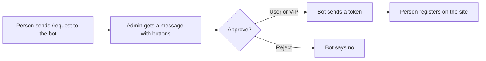
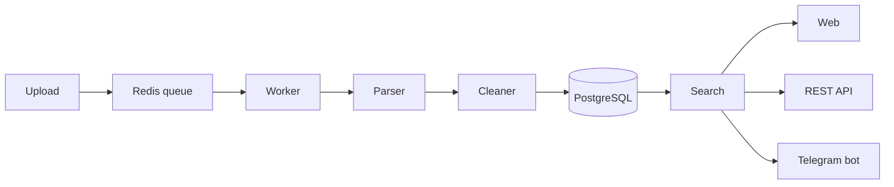

<div align="center">

# Research Database Search Engine

**Drop in any data file. Search it in a blink. From the web, the API or Telegram.**


[Quick start](#quick-start) · [Search](#search-that-forgives) · [Formats](#formats) · [Compression](#compression) · [Accounts](#accounts-and-roles) · [Bot](#telegram-bot) · [API](#api)

</div>

---

## Features

| | |
| --- | --- |
| **Eats everything** | 20+ formats: `csv` `xlsx` `pdf` `docx` `sql` `json` `xml` `html` `txt` and more |
| **Cleans itself** | HTML tags, duplicates, empty rows and columns, messy headers |
| **Forgiving search** | Typos, word beginnings, partial data, field filters |
| **Compress and keep searching** | Pack or merge files, search still works on packed data |
| **Telegram bot** | Search from your phone, approve access requests with one tap |
| **Real accounts** | Roles, monthly quotas, VIP expiry, blocking, audit log, stats |
| **Safe by default** | Daily backups, health checks, auto restart, JSON logs, migrations |
| **One card per person** | Records from all files are linked by phone and email into one card with every source |
| **Admin tools** | Edit, hide or delete a record right in the results |
| **Inbox folder** | Drop files into a folder and they are loaded on their own |
| **Monitoring** | Prometheus metrics and a ready Grafana dashboard |
| **Two languages** | Ukrainian and English, site and bot |
| **Black and purple UI** | Minimal, fast, no frameworks |

---

## Quick start

```bash
git clone https://github.com/12Viskas12/research-database-search-engine.git
cd research-database-search-engine
docker compose up --build
```

Open [localhost:8000](http://localhost:8000). The first start creates the creator account and prints the login:

```bash
docker compose logs app | grep ADMIN
```

The bot is optional. Put `BOT_TOKEN` into `.env` and start with the `bot` profile:

```bash
docker compose --profile bot up --build
```

<details>
<summary><b>Configuration</b></summary>

<br>

Settings are read from `.env`, see `.env.example`.

| Variable | Default | Description |
| --- | --- | --- |
| `BOT_TOKEN` | none | Telegram bot token, the bot is off without it |
| `SITE_URL` | `http://localhost:8000` | Link the bot sends with the token |
| `ADMIN_USERNAME` | `admin` | Login of the first account (the creator) |
| `ADMIN_PASSWORD` | random | Password of the first account, printed in the logs if empty |
| `QUOTA_USER` | `3` | Searches per month for the user role |
| `QUOTA_VIP` | `50` | Searches per month for the vip role |
| `DATABASE_URL` | `postgresql://postgres:postgres@db:5432/search` | PostgreSQL connection |
| `REDIS_URL` | `redis://redis:6379` | Redis connection |
| `UPLOAD_DIR` | `/data/uploads` | Where uploaded files are stored |
| `LOG_LEVEL` | `INFO` | Log level |
| `BACKUP_EVERY_HOURS` | `24` | Backup interval |
| `BACKUP_KEEP` | `7` | How many backups to keep |
| `INGEST_WORKERS_MAX` | `8` | Upper limit of parallel connections that load one file. The real number is chosen automatically |
| `INBOX_DIR` | `/data/inbox` | Folder that is scanned for new files |
| `BACKUP_DIR` | `/backups` | Where the app reads backups from |
| `METRICS_TOKEN` | none | If set, `/metrics` needs `Authorization: Bearer TOKEN` |
| `GRAFANA_PASSWORD` | `admin` | Grafana admin password |

</details>

---

## Search that forgives

Search runs in stages. The first stage with results wins.

| Stage | What it does | Example |
| --- | --- | --- |
| 1. Exact | All words match | `ivan petrenko` |
| 2. Smart | Exact, prefix or typo (1 to 2 edits) per word | `ivn petrenk` |
| 3. Substring | The whole query inside the text, digits included | `380442223` |
| 4. Relaxed | 3+ words: at least half must match | `maria shevchenko 380000000000` |

The last stage is the "name and surname, no phone" case: the phone is wrong or missing, the person is still found.

**Filters**

```text
tester city:Kyiv              one field plus free text
name:"Ivan Petrenko"          exact phrase in one field
```

Pick a file in the dropdown to search inside it only. Matches are highlighted, including the ones found through typos.

**Show more** loads the next page of the same search and does not touch your monthly limit. Every account also gets a **search history** with a repeat button.

---

**One card per person.** Search goes through live and packed files at once. Records that share a phone number or an email are merged into one card, every value is marked with the source it came from, and the full records are one click away. A card holds up to 20 records.

**Phones** are normalized: `+38 (050) 123-45-67`, `380501234567` and `0501234567` find each other. This applies to files uploaded after the update.

**Results tools**

- Sort by any field and hide fields you do not need, the choice is remembered.
- **Download CSV** exports up to 5000 results of the current search, repeating the same search is free.
- **Check a list** takes up to 100 values (one per line), tells which ones were found and exports the answer to CSV. One check counts as one search.

## Formats

| Type | Extensions |
| --- | --- |
| Tables | `csv` `tsv` `xlsx` `xlsm` `xls` `ods` |
| Structured | `json` `jsonl` `ndjson` `xml` `sql` |
| Documents | `pdf` `docx` `html` `htm` |
| Text | `txt` `log` `md` `dat` and any other text file |

Archives (`zip` `7z` `tar` `tar.gz` `tgz` `tar.bz2` `tar.xz` `gz` `bz2` `xz`) are unpacked automatically, including archives inside archives, and every supported file inside is loaded as a separate file. This works for uploads, the inbox and links.

SQL dumps are read from `INSERT` and `COPY` statements. Encodings like cp1251 are detected automatically.

---

## Compression

Rows are packed into blocks of 2000 and compressed with `bz2`, `zlib` or `lzma`. Every block has a tiny Bloom filter of its words, so search skips blocks that cannot match and unpacks only the rest. Results come from live and packed files together.

```bash
curl -b jar -X POST "localhost:8000/api/compress/files/1/pack?method=bz2"
curl -b jar -X POST localhost:8000/api/compress/merge -H "Content-Type: application/json" -d '{"name": "all"}'
curl -b jar -X POST localhost:8000/api/compress/reclaim
```

- **Pack** one file and unpack it back any time.
- **Merge** many files into one packed file, each row keeps its `source_file`.
- **Auto compression** packs files right after upload or after N days. The worker checks every 10 minutes. Set it in the Files tab.
- **Inbox.** Put a file into the `inbox` folder next to `docker-compose.yml`. The worker checks it every minute, takes finished files, skips duplicates (moved to `inbox/_duplicates`) and unsupported types (moved to `inbox/_rejected`).
- **Link.** An admin pastes a link in the Files tab, the worker downloads the file or archive itself and loads it. Local and private addresses are refused.
- **Delete** removes a file with all its records, **Retry** reruns a failed file, a file with the same content is rejected as a duplicate.
- If the worker restarts in the middle of a task, interrupted files are restarted or marked automatically.
- **Reclaim** returns disk space after packing and briefly locks the tables.

---

## Accounts and roles

Registration works only with a token.



Without the bot the admin creates tokens in the Tokens tab.

| Role | Searches per month | Access |
| --- | --- | --- |
| user | 3 | search |
| vip | 50 | search |
| admin | unlimited | everything: files, compression, requests, tokens, users, log |
| creator | unlimited | the same as admin, plus managing admins |

- The limit is per month and resets on the 1st at 00:00 UTC. Search and "I'm feeling lucky" both count.
- VIP can have a term: 7, 30, 90, 365 days or forever. After that the account becomes a normal user.
- Blocked users cannot log in or search, their sessions close at once. Admins cannot be blocked.
- The first account is the creator. Only the creator can give or take the admin role, invite admins, or delete admins. Admins cannot change each other, and nobody can change the creator.
- The **Stats** tab shows searches per day, top queries, active users and database size.
- Ranks grow with every search: Rookie, Tracker, Sleuth, Detective, Sherlock.
- Password change in the Profile tab closes other sessions. The admin can reset any password.
- Failed logins are limited in Redis: 8 per login and address, 40 per address in 10 minutes.
- The **Log** tab shows logins, role changes, uploads, compression and more, with filters.

---

## Telegram bot

| Command | Action |
| --- | --- |
| `/request text` | Ask for access |
| `/status` | Check the request or the account |
| `/link CODE` | Link your account, the code is in the Profile tab |
| `/id` | Show your Telegram ID |
| any text | Search, the five best matches |

The bot uses the same account and the same monthly limit as the site. It answers in Ukrainian or English, by the language of your Telegram.

Admins with a linked Telegram get every new request in the chat with buttons: **User**, **VIP 30 days**, **VIP forever**, **Reject**. One tap and the token goes to the requester.

---

## API

| Method | Path | Description |
| --- | --- | --- |
| `POST` | `/api/auth/register` | Register with a token |
| `POST` | `/api/auth/login` | Log in |
| `POST` | `/api/auth/logout` | Log out |
| `GET` | `/api/auth/me` | Profile, quota and rank |
| `POST` | `/api/auth/password` | Change the password |
| `POST` | `/api/auth/tg-code` | Code for linking Telegram |
| `DELETE` | `/api/auth/tg` | Unlink Telegram |
| `GET` | `/api/search?q=text&limit=20&offset=0&files=1,2&search_id=5` | Search, results come as cards with linked records |
| `GET` | `/api/sources` | Files available for the filter |
| `GET` | `/api/export?q=text&files=1,2&search_id=5` | Results as CSV, up to 5000 rows |
| `POST` | `/api/search/bulk` | Check a list of values, up to 100 |
| `GET` | `/api/history` | Search history |
| `DELETE` | `/api/history` | Clear search history |
| `GET` | `/api/lucky` | Random record |
| `POST` | `/api/files` | Upload a file or archive, admin |
| `POST` | `/api/files/url` | Download a file or archive from a link, admin |
| `DELETE` | `/api/files/{id}` | Delete a file with its records, admin |
| `POST` | `/api/files/{id}/retry` | Rerun a failed file, admin |
| `GET` | `/api/files` | Files with status and progress, admin |
| `POST` | `/api/compress/files/{id}/pack` | Compress one file, admin |
| `POST` | `/api/compress/files/{id}/unpack` | Restore a compressed file, admin |
| `POST` | `/api/compress/merge` | Merge files into one, admin |
| `POST` | `/api/compress/reclaim` | Free disk space, admin |
| `GET` | `/api/compress/stats` | Sizes before and after, admin |

Admin only: `/api/admin/*` for requests, tokens, users, blocking, password reset, audit log, stats, settings, records (`PATCH`, `POST .../hide`, `DELETE`), searches without results (`/missed`) and backups (`/backups`).

`GET /health` checks the database and Redis. `GET /metrics` serves Prometheus metrics.

```bash
curl -c jar -H "Content-Type: application/json" -d '{"username":"admin","password":"..."}' localhost:8000/api/auth/login
curl -b jar -F "file=@data.csv" localhost:8000/api/files
curl -b jar "localhost:8000/api/search?q=Kyiv"
```

---

## Operations

- **Backups.** The `backup` service dumps the database every 24 hours and keeps the last 7 files in the `backups` volume (`BACKUP_EVERY_HOURS`, `BACKUP_KEEP`). The **Backups** tab lists them, creates a new one, downloads a file and restores the database from it. A restore makes a safety copy first. After a restore, restart `app` and `worker`:

```bash
docker compose restart app worker
```

- **Searches without results.** The **No results** tab shows what people searched for and did not find, a hint about which data to add.
- **Monitoring.** Start Prometheus and Grafana with the `monitoring` profile:

```bash
docker compose --profile monitoring up -d
```

Grafana is on [localhost:3000](http://localhost:3000) (login `admin`, password from `GRAFANA_PASSWORD`), Prometheus on [localhost:9090](http://localhost:9090). The dashboard is already there: requests, errors, latency, searches, queue, users, files, database size and time since the last backup.

- **Health.** `app` and `worker` have health checks, all services restart on failure.
- **Logs.** JSON lines to stdout, level from `LOG_LEVEL`, Docker keeps 3 files of 10 MB per service.
- **Migrations.** Schema changes are numbered in `app/db/db_models.py` and applied once at startup.
- **CI.** GitHub Actions runs `ruff`, a syntax check and a Docker build on every push.

## How it works



1. The file is saved and a job goes to the Redis queue.
2. The worker reads it with the right parser and cleans the rows.
3. Records land in PostgreSQL in batches, with a progress bar in the UI.
4. Search uses a `tsvector` index, trigram indexes and a word list for typos.

| Part | Tool |
| --- | --- |
| API and web | FastAPI, Jinja2 |
| Database | PostgreSQL, `pg_trgm` |
| Queue | Redis, arq |
| Bot | aiogram |
| Cleaning | pandas |
| Run | Docker Compose |

<details>
<summary><b>Project structure</b></summary>

<br>

```text
app/
  core/        settings, Redis
  db/          connection pool, schema
  parsers/     one parser per format
  routers/     auth, admin, files, compress, search, pages
  services/    cleaner, ingestion, search, linking, compression, accounts, audit, stats, metrics
  static/      css, js, translations
  templates/   html
scripts/       database backup
monitoring/    Prometheus and Grafana config
inbox/         drop files here
bot/           Telegram bot
workers/       background tasks
```

</details>

---

## License

See [LICENSE](LICENSE).
