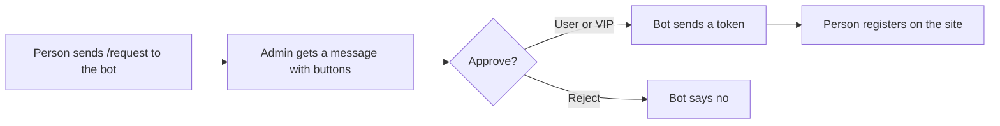
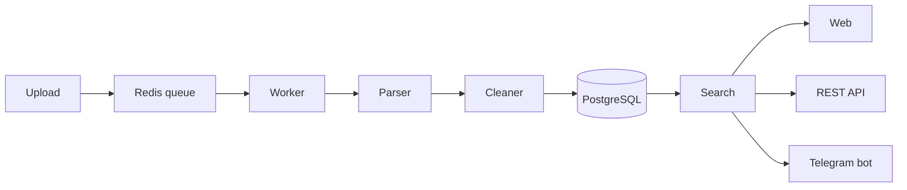

<div align="center">

# Research Database Search Engine

**Drop in any data file. Search it in a blink. From the web, the API or Telegram.**


[Quick start](#quick-start) · [Search](#search-that-forgives) · [Formats](#formats) · [Compression](#compression) · [Accounts](#accounts-and-roles) · [Bot](#telegram-bot) · [API](#api)

</div>

---

## Features

| | |
| --- | --- |
| **Eats everything** | 20+ formats: `csv` `xlsx` `pdf` `docx` `sql` `json` `xml` `html` `txt` and more |
| **Cleans itself** | HTML tags, duplicates, empty rows and columns, messy headers |
| **Forgiving search** | Typos, word beginnings, partial data, field filters |
| **Compress and keep searching** | Pack or merge files, search still works on packed data |
| **Telegram bot** | Search from your phone, approve access requests with one tap |
| **Real accounts** | Roles, daily quotas, VIP expiry, audit log |
| **Black and purple UI** | Minimal, fast, no frameworks |

---

## Quick start

```bash
git clone https://github.com/12Viskas12/research-database-search-engine.git
cd research-database-search-engine
docker compose up --build
```

Open [localhost:8000](http://localhost:8000). The first start creates an admin and prints the login:

```bash
docker compose logs app | grep ADMIN
```

The bot is optional. Put `BOT_TOKEN` into `.env` and start with the `bot` profile:

```bash
docker compose --profile bot up --build
```

<details>
<summary><b>Configuration</b></summary>

<br>

Settings are read from `.env`, see `.env.example`.

| Variable | Default | Description |
| --- | --- | --- |
| `BOT_TOKEN` | none | Telegram bot token, the bot is off without it |
| `SITE_URL` | `http://localhost:8000` | Link the bot sends with the token |
| `ADMIN_USERNAME` | `admin` | First admin login |
| `ADMIN_PASSWORD` | random | First admin password, printed in the logs if empty |
| `QUOTA_USER` | `5` | Searches per day for the user role |
| `QUOTA_VIP` | `50` | Searches per day for the vip role |
| `DATABASE_URL` | `postgresql://postgres:postgres@db:5432/search` | PostgreSQL connection |
| `REDIS_URL` | `redis://redis:6379` | Redis connection |
| `UPLOAD_DIR` | `/data/uploads` | Where uploaded files are stored |

</details>

---

## Search that forgives

Search runs in stages. The first stage with results wins.

| Stage | What it does | Example |
| --- | --- | --- |
| 1. Exact | All words match | `ivan petrenko` |
| 2. Smart | Exact, prefix or typo (1 to 2 edits) per word | `ivn petrenk` |
| 3. Substring | The whole query inside the text, digits included | `380442223` |
| 4. Relaxed | 3+ words: at least half must match | `maria shevchenko 380000000000` |

The last stage is the "name and surname, no phone" case: the phone is wrong or missing, the person is still found.

**Filters**

```text
tester city:Kyiv              one field plus free text
name:"Ivan Petrenko"          exact phrase in one field
```

Pick a file in the dropdown to search inside it only. Matches are highlighted, including the ones found through typos.

**Show more** loads the next page of the same search and does not touch your daily limit. Every account also gets a **search history** with a repeat button.

---

## Formats

| Type | Extensions |
| --- | --- |
| Tables | `csv` `tsv` `xlsx` `xlsm` `xls` `ods` |
| Structured | `json` `jsonl` `ndjson` `xml` `sql` |
| Documents | `pdf` `docx` `html` `htm` |
| Text | `txt` `log` `md` `dat` and any other text file |

SQL dumps are read from `INSERT` and `COPY` statements. Encodings like cp1251 are detected automatically.

---

## Compression

Rows are packed into blocks of 2000 and compressed with `bz2`, `zlib` or `lzma`. Every block has a tiny Bloom filter of its words, so search skips blocks that cannot match and unpacks only the rest. Results come from live and packed files together.

```bash
curl -b jar -X POST "localhost:8000/api/compress/files/1/pack?method=bz2"
curl -b jar -X POST localhost:8000/api/compress/merge -H "Content-Type: application/json" -d '{"name": "all"}'
curl -b jar -X POST localhost:8000/api/compress/reclaim
```

- **Pack** one file and unpack it back any time.
- **Merge** many files into one packed file, each row keeps its `source_file`.
- **Auto compression** packs files right after upload or after N days. The worker checks every 10 minutes. Set it in the Files tab.
- **Reclaim** returns disk space after packing and briefly locks the tables.

---

## Accounts and roles

Registration works only with a token.



Without the bot the admin creates tokens in the Tokens tab.

| Role | Searches per day | Access |
| --- | --- | --- |
| user | 5 | search |
| vip | 50 | search |
| admin | unlimited | everything: files, compression, requests, tokens, users, log |

- The limit resets at 00:00 UTC. Search and "I'm feeling lucky" both count.
- VIP can have a term: 7, 30, 90, 365 days or forever. After that the account becomes a normal user.
- Ranks grow with every search: Новичок → Следопыт → Сыщик → Детектив → Шерлок.
- Password change in the Profile tab closes other sessions. The admin can reset any password.
- Failed logins are limited in Redis: 8 per login and address, 40 per address in 10 minutes.
- The **Log** tab shows logins, role changes, uploads, compression and more, with filters.

---

## Telegram bot

| Command | Action |
| --- | --- |
| `/request text` | Ask for access |
| `/status` | Check the request or the account |
| `/link CODE` | Link your account, the code is in the Profile tab |
| `/id` | Show your Telegram ID |
| any text | Search, the five best matches |

The bot uses the same account and the same daily limit as the site.

Admins with a linked Telegram get every new request in the chat with buttons: **User**, **VIP 30 days**, **VIP forever**, **Reject**. One tap and the token goes to the requester.

---

## API

| Method | Path | Description |
| --- | --- | --- |
| `POST` | `/api/auth/register` | Register with a token |
| `POST` | `/api/auth/login` | Log in |
| `POST` | `/api/auth/logout` | Log out |
| `GET` | `/api/auth/me` | Profile, quota and rank |
| `POST` | `/api/auth/password` | Change the password |
| `POST` | `/api/auth/tg-code` | Code for linking Telegram |
| `DELETE` | `/api/auth/tg` | Unlink Telegram |
| `GET` | `/api/search?q=text&limit=20&offset=0&files=1,2&search_id=5` | Search records |
| `GET` | `/api/sources` | Files available for the filter |
| `GET` | `/api/history` | Search history |
| `DELETE` | `/api/history` | Clear search history |
| `GET` | `/api/lucky` | Random record |
| `POST` | `/api/files` | Upload a file, admin |
| `GET` | `/api/files` | Files with status and progress, admin |
| `POST` | `/api/compress/files/{id}/pack` | Compress one file, admin |
| `POST` | `/api/compress/files/{id}/unpack` | Restore a compressed file, admin |
| `POST` | `/api/compress/merge` | Merge files into one, admin |
| `POST` | `/api/compress/reclaim` | Free disk space, admin |
| `GET` | `/api/compress/stats` | Sizes before and after, admin |

Admin only: `/api/admin/*` for requests, tokens, users, password reset, audit log and settings.

```bash
curl -c jar -H "Content-Type: application/json" -d '{"username":"admin","password":"..."}' localhost:8000/api/auth/login
curl -b jar -F "file=@data.csv" localhost:8000/api/files
curl -b jar "localhost:8000/api/search?q=Kyiv"
```

---

## How it works



1. The file is saved and a job goes to the Redis queue.
2. The worker reads it with the right parser and cleans the rows.
3. Records land in PostgreSQL in batches, with a progress bar in the UI.
4. Search uses a `tsvector` index, trigram indexes and a word list for typos.

| Part | Tool |
| --- | --- |
| API and web | FastAPI, Jinja2 |
| Database | PostgreSQL, `pg_trgm` |
| Queue | Redis, arq |
| Bot | aiogram |
| Cleaning | pandas |
| Run | Docker Compose |

<details>
<summary><b>Project structure</b></summary>

<br>

```text
app/
  core/        settings, Redis
  db/          connection pool, schema
  parsers/     one parser per format
  routers/     auth, admin, files, compress, search, pages
  services/    cleaner, ingestion, search, compression, accounts, audit
  static/      css, js
  templates/   html
bot/           Telegram bot
workers/       background tasks
```

</details>

---

## License

See [LICENSE](LICENSE).
